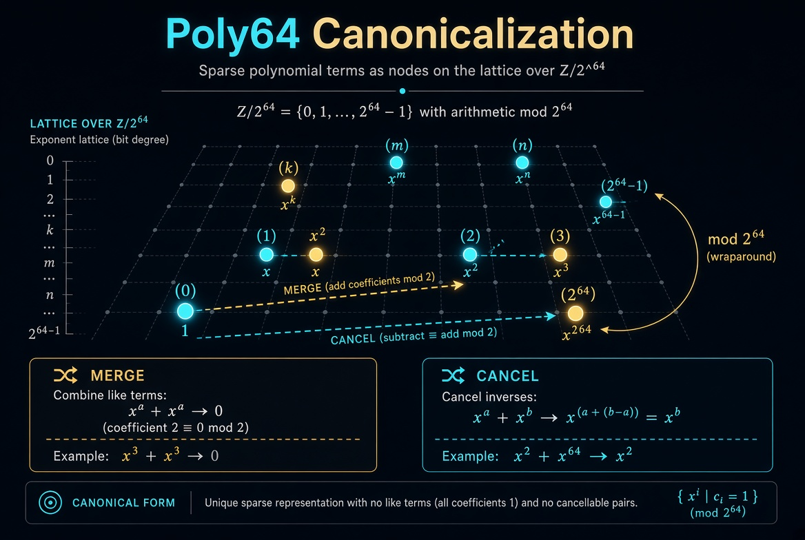
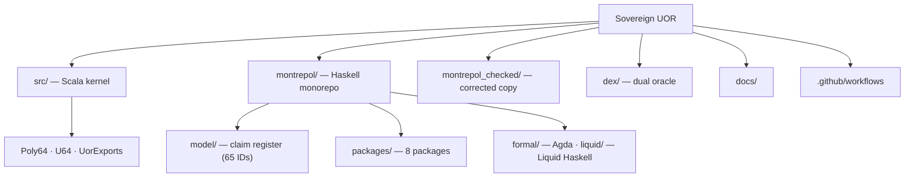

# Sovereign UOR

Sovereign UOR is the Universal Object Reference codebase. It holds exact mathematics in Haskell, with every claim tied to a test that can fail, plus a Scala kernel for sparse polynomials over Z/2^64 and a Dex dual oracle that checks both. The Haskell tree depends on nothing but GHC: no Hackage packages, no Rust, no Python. The test harness, the pseudorandom generator, the TOML reader, and every algorithm are written here. This repository consolidates the parts of five earlier repositories that held real mathematics, and drops the rest.

## What is in the repo

| Directory | Language | What it does |
|---|---|---|
| `src/` | Scala 3 | Sparse polynomials over Z/2^64 (`Poly64`), with a C ABI through GraalVM native-image. 8 unit tests. |
| `montrepol/` | Haskell | The author's monorepo: exact mathematics under a claim discipline. 8 packages, a claim register of 65 IDs, a gate, and 34 planted mutants. |
| `montrepol_checked/` | Haskell | A corrected copy of an earlier tree. It builds and passes its own tests, and the Dex determinant check reads it. It is not the author's code. |
| `dex/` | Dex, Scala, Haskell | A dual oracle: the same inputs run through the repository code and through Dex, and the outputs must match byte for byte. |
| `docs/` | Markdown | Audit notes, the Dex oracle notes, a Poly64 walkthrough, and verbatim copies of earlier documents. |
| `haskell/` | Haskell | The UOR state vector: Weyl reflections, canonicalization, chamber coordinates, digest. |
| `lean/` | Lean 4 | Lean formalization of the UOR state vector: 3-axis integer coordinates before Weyl-orbit quotienting, and B_n canonicalization for arbitrary n. Core only, no Mathlib. |
| `.github/workflows/` | YAML | CI, the honesty replay, and the Dex oracle. |

File counts at HEAD: `src/` 4, `dex/` 4, `docs/` 8, `haskell/` 1, `lean/` 2, `montrepol/` 73, `montrepol_checked/` 38, `.github/` 3. The root also holds `LICENSE`, `README.md`, `WATERMARK.md`, and `.gitignore`.

## The Haskell packages (`montrepol/packages/`)

| Package | What it does | Checked against |
|---|---|---|
| `mp-check` | Test harness: SplitMix64, generators, properties, ID-tagged tests | An independent C SplitMix64; a planted false property |
| `mp-linalg` | Semirings, matrices with dimensions in the type, naive and Strassen products, Bareiss determinant, rank, inverse, participation ratio | Leibniz expansion, the definition of the product, Floyd–Warshall |
| `mp-lie` | Root systems A–G, simple roots, Cartan matrices, Weyl group orders by orbit–stabilizer | The classification tables (Bourbaki, Humphreys) |
| `mp-seq` | Berlekamp–Massey over any field, LFSRs, periods | Brute-force minimality; Massey's 2L theorem |
| `mp-analytic` | Sieve, von Mangoldt, Chebyshev ψ, exact Bernoulli numbers, ζ by Euler–Maclaurin, Riemann–Siegel θ, Hardy Z, zeros, the explicit formula | Trial division, OEIS, lcm(1..x), von Staudt–Clausen, closed forms of ζ, Odlyzko's table |
| `mp-hcalc` | Hcalc: a certifying SMT core. DPLL SAT with resolution refutations, Fourier–Motzkin linear arithmetic over ℚ with Farkas certificates, DPLL(T) over both | Brute-force truth tables, grids of rational points, independent certificate checkers |
| `mp-lambda` | The simply typed λ-calculus, and refinement types over it whose verification conditions Hcalc decides | Progress, preservation, substitution on random terms; accepted programs are run and postconditions checked |
| `mp-gate` | The gate: rules R1–R6 over the model, sources, proofs, the Liquid layer, and the build; mutant replay | Its own planted defects |

## How a claim earns its level

Every claim is a row in `montrepol/model/ids.toml` — 65 IDs at HEAD (AN 6, CK 4, DX 4, GT 12, HC 8, LA 10, LI 6, LM 10, SQ 5). Each row names its package, its claim, and its oracle. Twelve authorities are listed in `model/authorities.toml`. The gate (`mp-gate`) checks six rules over the model, the sources, and the build.

| Level | Meaning |
|---|---|
| `some-true` | Reproduced from an authority. Not established here. |
| `build` | Constructed here and checked against an oracle by a test. Evidence, not proof. |
| `open` | Measured and reported. Never asserted. |
| `proved` | Machine-checked by Agda under `--safe`, with no postulates. |
| `refined` | Checked by Liquid Haskell. |

| Rule | What it checks |
|---|---|
| R1 | The committed `CONFORMANCE.md` is exactly what the model generates. |
| R2 | No open claim carries an asserting word, and no `some-true` claim lacks an authority. |
| R3 | Every ID has a test, and every test tag is registered. |
| R4 | No deferral markers or stubs in code. |
| R5 | No partial functions, and no missing `-Werror`. |
| R6 | No outside dependencies, and no re-enabled package repository. |

The mutants prove the tests can fail. Defects are planted in the code — a wrong Strassen product, a Bareiss row swap without the sign flip, a dropped Euler–Maclaurin term — and the gate replays them, restoring every file after. There are 34 planted mutants at HEAD.

## How to build and verify

| Command | What it proves |
|---|---|
| `scala-cli test --scala 3.5.2 --test-only uor.kernel.Poly64Test src/main/scala/uor/kernel src/test/scala/uor/kernel/Poly64Test.scala` | The Scala kernel: 8 tests pass. |
| `cd montrepol && cabal build all` | All packages build with `-Werror`, zero warnings. |
| `cabal test all` | The test suites pass. |
| `cabal run mp-gate` | Rules R1–R6 hold over the model, sources, and build. |
| `cabal run mp-gate -- mutants` | Every planted mutant is caught; every file is restored. |
| `cabal run mp-gate -- write && git diff --exit-code CONFORMANCE.md` | The committed register is exactly what the model generates. |
| `cabal run mp-analytic-report` | The zeros are found and the explicit-formula error table matches the ledger. |
| `cd montrepol_checked && cabal build all && cabal test all` | The corrected copy builds and passes its tests. |

Needs GHC 9.10.1, cabal 3.12.1.0, and Java 21 with scala-cli. The Dex side needs a dex-lang build; the steps are in `docs/dex-oracle.md`.

## Measured state

Last measured run, commit `ee9176b` (2026-11-15), on the build machine (GHC 9.10.1, cabal 3.12.1.0, Scala 3.5.2 on Java 21, Dex at `25e2e389`). Nothing here is estimated. The tree has grown since — 65 IDs, 34 mutants, and 8 packages at HEAD — so these numbers describe that run, not today's tree.

| Check | Result |
|---|---|
| `montrepol` build | All packages build, 0 warnings under `-Werror` |
| `montrepol` tests | 171 pass, 0 fail (mp-analytic 10, mp-check 5, mp-gate 23, mp-lie 106, mp-linalg 19, mp-seq 8) |
| `montrepol` gate | R1–R6 hold over the 6 packages that existed then |
| `montrepol` mutants | 13 of 13 caught (the count then) |
| `montrepol` conformance | Committed register is exactly what the model generates |
| `mp-analytic-report` | 512 zeros on (10, 827]; error table identical to the ledger; 2.4 s |
| `montrepol_checked` tests | 80 pass; 10 of 10 mutants caught |
| Dex Poly64 | 600 of 600 lines identical |
| Dex determinant | 200 of 200 identical (against `montrepol_checked`'s Bareiss) |
| Scala tests | 8 pass |

## Where the two Haskell trees come from

The tree now in `montrepol/` is the author's code, restored from his own zip in nine commits on 2026-11-15. It replaced an earlier tree. `montrepol_checked/` is a corrected copy of that earlier tree. It stays in the repo because CI builds it and the Dex determinant check reads it.

## Open gaps

| Gap |
|---|
| No workflow GitHub executes runs the restored tree's tests, gate, conformance check, or mutant replay. Its own `ci.yml` and `honesty.yml` sit under `montrepol/.github/`, where GitHub does not look. |
| The Dex determinant check covers `montrepol_checked`, not the author's `det`. |
| `Poly64` compares by reference: two equal polynomials are not `==`, because the case class holds arrays. Its arrays are public and mutable, and `fromRaw` accepts exponent vectors of the wrong length. No test calls the four `UorExports` entry points. |
| The zeta table was compared with LMFDB, not with Odlyzko's own files, which could not be reached. |
| The explicit-formula error is measured, not bounded, as the ledger already says. |

## License

AGPL-3.0-only OR LicenseRef-SnapKitty-Opaque-1.0. The AGPL text is in [LICENSE](LICENSE).
